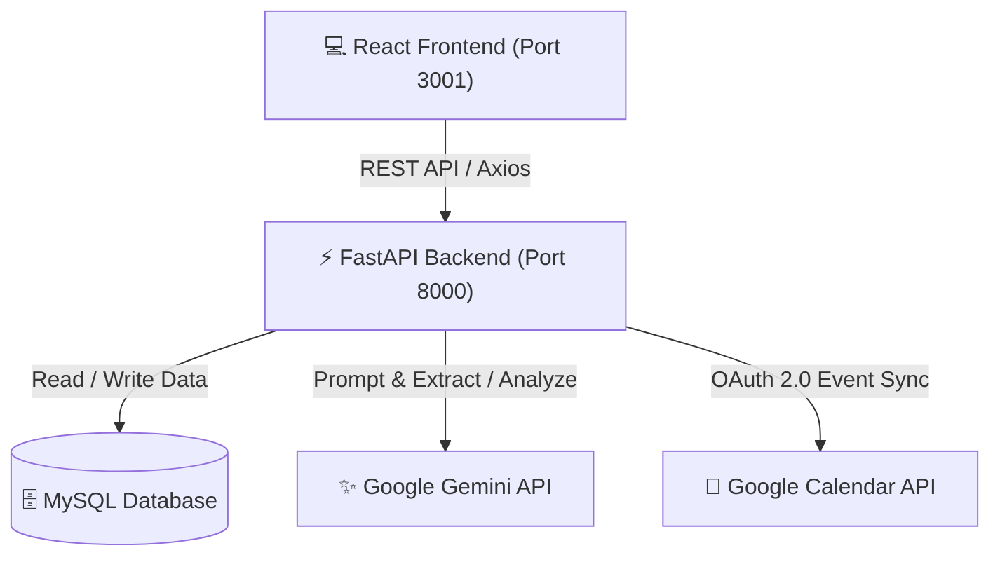

# ⚖️ AI Legal Analyzer & Risk Predictor

<p align="center">
  
  
  
  
  
  
</p>

<p align="center">
  <strong>An intelligent, end-to-end legal intelligence platform that automates contract analysis, clause risk prediction, deadline extraction, calendar synchronization, and interactive AI legal consulting.</strong>
</p>

---

## 📑 Table of Contents

- [Overview](#-overview)
- [Key Features](#-key-features)
- [System Architecture](#-system-architecture)
- [Tech Stack](#-tech-stack)
- [Project Structure](#-project-structure)
- [Getting Started](#-getting-started)
  - [Prerequisites](#prerequisites)
  - [1. Clone and Install Dependencies](#1-clone-and-install-dependencies)
  - [2. Environment Configuration](#2-environment-configuration)
  - [3. Database Setup & Migrations](#3-database-setup--migrations)
  - [4. Launch Application](#4-launch-application)
- [Google Calendar Sync Setup (Optional)](#-google-calendar-sync-setup-optional)
- [API Documentation](#-api-documentation)
- [Troubleshooting](#-troubleshooting)
- [Contributing & License](#-license)

---

## 🌟 Overview

Navigating complex contracts and legal documents is time-consuming, prone to oversight, and legally risky. The **AI Legal Analyzer & Risk Predictor** bridges this gap by leveraging **Google Gemini AI** and Natural Language Processing to instantly digest multi-page agreements, pinpoint high-liability clauses, score contract risks, extract actionable deadlines, and offer continuous assistance through a dedicated legal AI copilot.

---

## ✨ Key Features

| Feature | Description |
| :--- | :--- |
| 📄 **Document Ingestion & OCR** | Upload agreements in **PDF**, **DOCX**, or **TXT** format with automatic text parsing and preprocessing. |
| 🔍 **Deep Risk Scoring & Analysis** | Categorize contract clauses into Low, Medium, and High-risk tiers with actionable explanations and recommendations. |
| 📑 **Executive Summarization** | Generates plain-language legal summaries, key highlights, and liability overviews. |
| 💬 **Interactive Legal Copilot** | Context-aware legal assistant powered by Gemini. Ask follow-up questions directly on your analyzed documents with saved chat sessions. |
| 📅 **Deadline Extraction & Calendar Sync** | Detects critical dates (renewals, notice periods, deliverables) and syncs them to **Google Calendar** via OAuth 2.0. |
| 📊 **Admin Oversight & Analytics** | Centralized dashboard for platform stats, document tracking, user role management, and risk distribution charts with Recharts. |
| 🔐 **Authentication & RBAC** | Secure role-based access control distinguishing between standard users and platform administrators. |

---

## 🏛️ System Architecture



---

## 🛠️ Tech Stack

### Frontend
- **Framework**: React 18 (SPA)
- **Styling**: Tailwind CSS, Lucide React icons
- **Data Visualization**: Recharts
- **Markdown Rendering**: React Markdown, Remark GFM
- **Routing & Networking**: React Router v6, Axios

### Backend
- **Framework**: FastAPI (Python 3.10+)
- **Server**: Uvicorn ASGI
- **AI & NLP**: Google GenAI SDK (`google-genai`), NLTK, VaderSentiment
- **Document Processing**: PyPDF2, python-docx
- **Database Driver**: MySQL Connector Python
- **Environment Management**: Python-dotenv, Pydantic Settings

### Database & Integrations
- **Database**: MySQL 8.x
- **External APIs**: Google Gemini Flash Models (`gemini-2.5-flash`), Google Calendar API

---

## 📁 Project Structure

```plaintext
AI_Legal_Analyzer-main/
├── .env.example                  # Project-wide environment template
├── .gitignore                    # Git ignore rules
├── package.json                  # Root npm runner scripts
├── setup.bat                     # Windows one-click environment setup script
├── run_migrations.py             # Python database migration runner
├── RUN_MIGRATIONS.bat            # Batch migration script
├── QUICKSTART.md                 # Quick setup instructions
│
├── backend/                      # FastAPI Backend
│   ├── main.py                   # Main FastAPI application entry point
│   ├── database.py               # MySQL connection & pooling
│   ├── gemini_combined.py        # Gemini analysis & prompt orchestrator
│   ├── summarizer.py             # Contract summarizer service
│   ├── risk_service.py           # Legal risk calculation logic
│   ├── chat_gemini_service.py    # AI Chat Assistant service
│   ├── chat_routes.py            # Chat session & history API routes
│   ├── calendar_service.py       # Event extraction service
│   ├── calendar_events_routes.py # Calendar event CRUD routes
│   ├── google_calendar_sync.py   # Google Calendar OAuth sync client
│   ├── google_oauth_setup.py     # Desktop OAuth client setup utility
│   ├── requirements.txt          # Python dependencies
│   ├── .env.example              # Backend environment template
│   └── migrations/               # Database migration schemas
│       ├── 000_create_users_table.sql
│       ├── 001_add_analysis_json.sql
│       ├── 002_create_events_table.sql
│       └── 003_chat_assistant.sql
│
└── frontend/                     # React Frontend
    ├── public/                   # Public assets & HTML template
    ├── package.json              # Frontend dependencies
    ├── tailwind.config.js        # Tailwind CSS configuration
    ├── .env.example              # Frontend environment template
    └── src/
        ├── App.js                # App route mapping
        ├── index.js              # React entry point
        ├── context/              # User & auth state management
        ├── services/             # Axios API services
        └── components/           # UI components
            ├── Auth.jsx          # Login & Registration
            ├── Dashboard.jsx     # User dashboard
            ├── Uploader.jsx      # Document drag-and-drop uploader
            ├── AnalysisResults.jsx # Risk breakdown & summary display
            ├── ChatAssistant.jsx # AI conversational assistant
            ├── CalendarSync.jsx  # Calendar sync management
            ├── AdminOverview.jsx # Admin dashboard metrics
            └── PlatformAnalytics.jsx # Platform visual analytics
```

---

## 🚀 Getting Started

### Prerequisites

Make sure the following are installed on your machine:
- **Node.js** (v16.x or higher) & **npm**
- **Python** (v3.10 or higher) & **pip**
- **MySQL Server** (v8.x running locally or remotely)
- **Google Gemini API Key** ([Get a free key from Google AI Studio](https://aistudio.google.com/app/apikeys))

---

### 1. Clone and Install Dependencies

You can install all dependencies with a single command from the project root:

```bash
npm run install-all
```

*Or install manually:*

```bash
# Root dependencies
npm install

# Backend dependencies
cd backend
pip install -r requirements.txt

# Frontend dependencies
cd ../frontend
npm install
cd ..
```

---

### 2. Environment Configuration

1. Copy the example environment file for the backend:

   ```bash
   # On Windows:
   copy backend\.env.example backend\.env

   # On Linux/macOS:
   cp backend/.env.example backend/.env
   ```

2. Open `backend/.env` and supply your actual credentials:

   ```env
   # Database Configuration
   MYSQL_HOST=127.0.0.1
   MYSQL_PORT=3306
   MYSQL_DATABASE=legal_analyzer_db
   MYSQL_USER=root
   MYSQL_PASSWORD=your_actual_mysql_password

   # Gemini API Key
   GEMINI_API_KEY=your_actual_gemini_api_key

   # Gemini Models
   GEMINI_MODEL=gemini-2.5-flash
   GEMINI_SUMMARY_MODEL=gemini-2.5-flash

   # Google Calendar Timezone
   CALENDAR_TZ=UTC
   ```

3. *(Optional)* If your backend runs on a custom port or remote host, create `frontend/.env`:
   ```env
   REACT_APP_API_URL=http://127.0.0.1:8000
   ```

---

### 3. Database Setup & Migrations

1. Ensure MySQL is running and create the database:

   ```sql
   CREATE DATABASE legal_analyzer_db;
   ```

2. Run the automated migration script:

   ```bash
   python run_migrations.py
   ```

   *Alternatively, on Windows double-click `RUN_MIGRATIONS.bat` or execute the files in `backend/migrations/` sequentially in MySQL Workbench.*

---

### 4. Launch Application

Start both the backend and frontend simultaneously with one command:

```bash
npm run dev
```

The services will be available at:
- 🖥️ **Frontend**: [http://localhost:3001](http://localhost:3001)
- ⚙️ **Backend API**: [http://localhost:8000](http://localhost:8000)
- 📖 **Interactive Swagger Docs**: [http://localhost:8000/docs](http://localhost:8000/docs)

---

## 📅 Google Calendar Sync Setup (Optional)

To enable two-way sync for extracted contract deadlines:

1. Go to the [Google Cloud Console](https://console.cloud.google.com/).
2. Create a project and enable the **Google Calendar API**.
3. Create **OAuth 2.0 Client ID** credentials (Application Type: *Desktop Application*).
4. Download the credentials JSON and save it as:
   ```plaintext
   backend/credentials.json
   ```
5. Authorize access by running the OAuth setup script:
   ```bash
   python backend/google_oauth_setup.py
   ```
6. A browser window will open. Sign in to grant permissions. A `backend/token.json` file will be generated automatically.

---

## 📡 API Documentation

Interactive API documentation and schema exploration are accessible at `http://localhost:8000/docs`.

### Key Endpoints

| Category | Method | Endpoint | Description |
| :--- | :--- | :--- | :--- |
| **System** | `GET` | `/api/status` | Backend health check |
| **Auth** | `POST` | `/api/login` | User/Admin authentication |
| | `POST` | `/api/register` | User account registration |
| **Documents** | `POST` | `/api/documents/analyze` | Upload contract, run OCR, risk assessment & event extraction |
| | `GET` | `/api/documents/my` | Retrieve all documents belonging to current user |
| | `GET` | `/api/documents/{id}` | Retrieve specific document metadata and analysis |
| **Calendar** | `GET` | `/api/events` | Fetch all user contract deadlines & milestones |
| | `POST` | `/api/events` | Create new legal calendar event |
| | `POST` | `/api/events/{id}/sync` | Sync individual event to Google Calendar |
| | `DELETE`| `/api/events/{id}` | Remove a calendar event |
| **Chat Copilot**| `POST` | `/api/chat` | Send prompt to Gemini with legal context |
| | `GET` | `/api/sessions` | List user chat sessions |
| | `GET` | `/api/history/{session_id}` | Retrieve chat history for a session |
| **Admin** | `GET` | `/api/admin/stats` | Platform summary counts & ratios |
| | `GET` | `/api/admin/users` | List registered platform accounts |
| | `GET` | `/api/admin/analytics` | High-level risk and usage analytics |

---

## 🔧 Troubleshooting

<details>
<summary><strong>❌ MySQL Connection Failed</strong></summary>

- Verify MySQL is active: `mysqladmin -u root -p status`
- Check host, port, database name, and credentials in `backend/.env`.
- Ensure the database `legal_analyzer_db` has been created.
</details>

<details>
<summary><strong>❌ Gemini API Key Error or Quota Issue</strong></summary>

- Confirm `GEMINI_API_KEY` is present in `backend/.env`.
- Verify your API key has quota available at [Google AI Studio](https://aistudio.google.com/).
- Check model name setting: `GEMINI_MODEL=gemini-2.5-flash` or `gemini-2.0-flash`.
</details>

<details>
<summary><strong>❌ Port Already in Use (8000 or 3001)</strong></summary>

- Identify blocking processes on Windows:
  ```powershell
  netstat -ano | findstr :8000
  taskkill /PID <PID> /F
  ```
- Change the frontend port by modifying `PORT=3001` in `frontend/package.json`.
</details>

---

## 📄 License

This project is licensed under the [MIT License](LICENSE).
